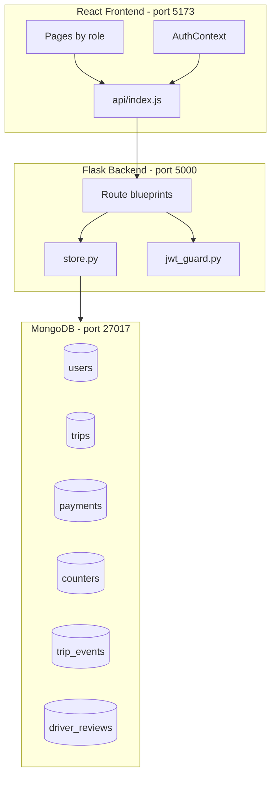

# RideBook — Project Guide

A full-stack ride booking application. This document explains how every part of the project works.

---

## 1. What this app does

RideBook connects three types of users:

| Role | What they do |
|------|----------------|
| **Passenger** | Book rides, track trips, pay, rate drivers |
| **Driver** | Go online, accept requests, complete trips, view earnings |
| **Admin** | View stats, manage users, monitor trips and payments |

All data is stored in **MongoDB**. There is no MySQL.

---

## 2. Architecture



**Request flow example (login):**

1. User submits email/password on `/login`
2. Frontend calls `POST /auth/login` via `api/index.js`
3. Backend checks `users` collection in MongoDB
4. If valid, returns JWT token + user info
5. Frontend saves token in `localStorage` and redirects to role dashboard

---

## 3. Project structure

```
ride-booking-app/
├── PROJECT_GUIDE.md      ← You are here
├── DATABASE_SETUP.md     ← MongoDB Compass setup
├── README.md
│
├── backend/
│   ├── app.py            ← Flask entry, registers routes, /health
│   ├── store.py          ← All database reads/writes
│   ├── config/mongo.py   ← MongoDB connection
│   ├── middleware/jwt_guard.py  ← Protects routes by role
│   └── routes/
│       ├── auth.py       ← Register, login
│       ├── passenger.py  ← Book, status, history, rate
│       ├── driver.py     ← Availability, requests, trip updates
│       ├── payment.py    ← Confirm payment
│       └── admin.py      ← Stats, users, trips, payments
│
├── frontend/
│   └── src/
│       ├── App.jsx           ← Router + AuthProvider
│       ├── routes/index.jsx  ← All URL paths
│       ├── api/index.js      ← HTTP client (axios)
│       ├── context/AuthContext.jsx
│       ├── components/
│       │   ├── layouts/AppShell.jsx
│       │   └── ui/           ← Shared UI pieces
│       └── pages/            ← Screens by role
│
└── scripts/
    └── seed_admin.py     ← Creates admin@ridebook.com
```

---

## 4. How to run

### Prerequisites
- Node.js 18+
- Python 3.10+
- MongoDB running locally

### Start MongoDB
Use **MongoDB Compass** → connect to `mongodb://127.0.0.1:27017`

### Backend
```powershell
cd backend
copy .env.example .env
pip install -r requirements.txt
python app.py
```
Runs at **http://localhost:5000**

### Seed admin (first time)
```powershell
python scripts/seed_admin.py
```
Login: `admin@ridebook.com` / `admin123`

### Frontend
```powershell
cd frontend
npm install
npm run dev
```
Opens at **http://localhost:5173**

### Health check
`GET http://localhost:5000/health` → `{ "api": "ok", "mongodb": "connected" }`

---

## 5. MongoDB collections

| Collection | Purpose |
|------------|---------|
| `users` | All accounts. Drivers have embedded `driver_profile` (vehicle, availability, rating) |
| `trips` | Every ride from request → completion |
| `payments` | Payment records after completed trips |
| `counters` | Auto-increment IDs (`user_id`, `trip_id`, `payment_id`) |
| `trip_events` | Status change log per trip |
| `driver_reviews` | Star ratings and comments |

### Sample user document (driver)
```json
{
  "user_id": 2,
  "name": "Alex",
  "email": "alex@example.com",
  "password": "<bcrypt hash>",
  "role": "driver",
  "is_active": true,
  "driver_profile": {
    "license_number": "DL123",
    "vehicle_model": "Toyota Prius",
    "vehicle_plate": "7XYZ89",
    "vehicle_type": "car",
    "is_available": true,
    "avg_rating": 4.8,
    "total_trips": 12
  }
}
```

### Trip statuses
```
requested → accepted → in_progress → completed
                              ↘ cancelled
```

---

## 6. Authentication

### Registration (`POST /auth/register`)
- Roles allowed: `passenger` or `driver`
- Password is hashed with **bcrypt** before storage
- Drivers must include license and vehicle details

### Login (`POST /auth/login`)
- Returns JWT valid for **24 hours**
- Token payload: `{ user_id, role, exp }`

### Protected routes
The `@token_required('passenger')` decorator:
1. Reads `Authorization: Bearer <token>` header
2. Decodes JWT
3. Blocks if role doesn't match

Frontend stores token in `localStorage` and attaches it to every API call via axios interceptor in `api/index.js`.

---

## 7. User flows

### Passenger journey
```
Register/Login
    → Dashboard
    → Book Ride (estimate fare → confirm)
    → Ride Status (polls every 5s)
    → Payment (after trip completed)
    → Rate Driver
    → Dashboard
```

**Book ride** sends pickup/dropoff text. The frontend converts place names to coordinates via `utils/locations.js`, then calls:
- `POST /passenger/estimate-fare`
- `POST /passenger/book-ride`

### Driver journey
```
Register/Login
    → Dashboard → toggle ONLINE
    → Incoming Requests (polls every 8s)
    → Accept ride
    → Active Trip (start → complete)
    → Earnings
```

Only **online** drivers with matching `vehicle_type` see open requests.

### Admin journey
```
Login
    → Dashboard (live stats from MongoDB)
    → Manage Users (suspend/activate)
    → Monitor Trips
    → Payment Audits
```

---

## 8. API reference

Base URL: `http://localhost:5000`

### Auth
| Method | Path | Auth | Description |
|--------|------|------|-------------|
| POST | `/auth/register` | No | Create account |
| POST | `/auth/login` | No | Get JWT token |

### Passenger
| Method | Path | Description |
|--------|------|-------------|
| POST | `/passenger/estimate-fare` | Calculate fare from coordinates |
| POST | `/passenger/book-ride` | Create trip (status: requested) |
| GET | `/passenger/ride-status/:id` | Trip + driver info + events |
| GET | `/passenger/ride-history` | Completed trips |
| POST | `/passenger/rate-driver/:id` | Submit 1–5 star review |

### Driver
| Method | Path | Description |
|--------|------|-------------|
| PATCH | `/driver/availability` | Set online/offline |
| GET | `/driver/ride-requests` | Open trips matching vehicle type |
| PATCH | `/driver/accept-ride/:id` | Assign self to trip |
| PATCH | `/driver/update-status/:id` | `in_progress` or `completed` |
| GET | `/driver/earnings` | Completed trips + payouts |

### Payment
| Method | Path | Description |
|--------|------|-------------|
| POST | `/payment/confirm` | Mark trip as paid |

### Admin
| Method | Path | Description |
|--------|------|-------------|
| GET | `/admin/stats` | User/trip/revenue counts |
| GET | `/admin/users` | List users (?role=, ?status=) |
| PATCH | `/admin/suspend-user/:id` | Suspend or activate |
| GET | `/admin/trips` | All trips |
| GET | `/admin/payments` | All payments |

---

## 9. Frontend routing

| Path | Role | Page |
|------|------|------|
| `/login` | Public | Login |
| `/register` | Public | Register |
| `/passenger/dashboard` | passenger | Dashboard |
| `/passenger/book` | passenger | Book ride |
| `/passenger/ride-status/:tripId` | passenger | Live status |
| `/passenger/history` | passenger | Past trips |
| `/passenger/payment/:tripId` | passenger | Pay |
| `/passenger/rate/:tripId` | passenger | Rate driver |
| `/driver/dashboard` | driver | Command center |
| `/driver/requests` | driver | Incoming requests |
| `/driver/active-trip/:tripId` | driver | Trip steps |
| `/driver/earnings` | driver | Earnings table |
| `/admin/dashboard` | admin | Analytics |
| `/admin/users` | admin | User management |
| `/admin/trips` | admin | Trip monitor |
| `/admin/payments` | admin | Payment audit |

`ProtectedRoute` redirects unauthenticated users to `/login` and wrong roles to `/unauthorized`.

---

## 10. Fare calculation

Located in `backend/routes/passenger.py`:

```
fare = $2.50 base + ($0.80 × distance in km)
```

Distance uses the Haversine formula between pickup and dropoff coordinates.

---

## 11. Key files explained

| File | Responsibility |
|------|----------------|
| `store.py` | Single source of truth for all MongoDB operations |
| `AuthContext.jsx` | Login state, token in localStorage |
| `api/index.js` | Axios instance + all API functions |
| `locations.js` | Maps place names → lat/lng for booking |
| `AppShell.jsx` | Sidebar layout shared by all roles |
| `jwt_guard.py` | Route protection decorator |

---

## 12. Environment variables

`backend/.env`:

```env
SECRET_KEY=your-secret-key
MONGO_URI=mongodb://127.0.0.1:27017/
MONGO_DB=ride_booking
```

---

## 13. Troubleshooting

| Problem | Fix |
|---------|-----|
| Login fails | Run `python scripts/seed_admin.py`, restart backend |
| `mongodb: error` on /health | Start MongoDB service or Compass |
| No ride requests for driver | Go **online** on dashboard; vehicle type must match trip |
| Booking estimate fails | Use place names from `locations.js` or `lat,lng` format |
| CORS errors | Backend must run on port 5000, frontend on 5173 |

---

## 14. Extending the app

**Add a new API endpoint:**
1. Add function in `store.py`
2. Add route in appropriate `routes/*.py`
3. Export helper in `frontend/src/api/index.js`
4. Call from page component

**Add a new page:**
1. Create component in `pages/`
2. Register route in `routes/index.jsx`
3. Add nav link in role layout (`AppShell` navItems)

---

## 15. Complete file & folder reference

> Sections 1–14 above describe an earlier ("Phase 1/2") version of the app (e.g. flat
> `pickup_location`/`dropoff_location` trips, `fare = $2.50 + $0.80/km`, `AppShell.jsx`,
> a single-nearest-driver `/driver/ride-requests` flow, Google Maps). The app has since
> evolved through Phase 3 (vehicle approvals) and Phase 4 (geospatial broadcast
> negotiation, online/offline, earnings/notifications/messages) and the map stack was
> migrated from Google Maps to OpenFreeMap/MapLibre. The reference below describes
> every file and folder as they actually exist in the repo today — trust this section
> (and the code) over sections 1–14 where they disagree.

### Root

| Path | Purpose |
|------|---------|
| `README.md` | Original project README from the Phase 1/2 era; kept for history, largely superseded. |
| `HOW_TO_RUN.md` | Quick-start guide — prerequisites, run commands, map stack (OpenFreeMap/Nominatim/OSRM), seed admin, test account credentials. |
| `PROJECT_GUIDE.md` | This file — architecture walkthrough, API reference, and (this section) the file/folder inventory. |
| `DATABASE_SETUP.md` | MongoDB Compass connection instructions. |
| `backend/`, `frontend/`, `scripts/` | The application — see below. |

### `backend/`

| Path | Purpose |
|------|---------|
| `app.py` | Flask entry point. Registers all route blueprints, configures CORS, creates MongoDB indexes at startup (wrapped in try/except so a down Mongo doesn't block boot), defines `GET /health`. |
| `store.py` | Single source of truth for all MongoDB reads/writes — user accounts, trip lifecycle, geospatial driver matching/broadcast negotiation, payments, driver earnings, notifications, messages, driver reviews, vehicle approvals. |
| `requirements.txt` | Python dependencies. |
| `.env` / `.env.example` | Backend config — `SECRET_KEY`, `MONGO_URI`, `MONGO_DB`. |
| `config/mongo.py` | MongoDB client setup (`init_mongo`, `get_mongo`, `check_mongo`). |
| `middleware/jwt_guard.py` | `@token_required('role', ...)` decorator — validates the `Authorization: Bearer <JWT>` header and attaches `request.user`. |
| `utils/fare_calculator.py` | Per-vehicle-type fare-rate table; server-side source of truth used to recalculate (never trust) a client-submitted fare. |
| `routes/auth.py` | `POST /auth/register`, `POST /auth/login` — bcrypt hashing, JWT issuance. |
| `routes/passenger.py` | Fare estimate, book ride (broadcast), ride status, ride history, cancellation, rating, accept/reject driver offers, chat messages. |
| `routes/driver.py` | Go online/offline, location updates, broadcast requests (accept-at-minimum / counter-offer / decline), active trip, status transitions, earnings, ride history, vehicle CRUD, chat messages. |
| `routes/admin.py` | Platform stats, user list/suspend, trip/payment lists, vehicle approvals, and a staged `/analytics` aggregation endpoint (not yet wired to any frontend page). |
| `routes/notifications.py` | List / mark-read endpoints for the shared notifications feed (all roles). |

### `scripts/`

| Path | Purpose |
|------|---------|
| `seed_admin.py` | One-time script that creates the seed admin account (`admin@ridebook.com`). |
| `reset_db.py` | Wipes all non-admin data (trips, trip events, payments, earnings, notifications, messages, vehicles, reviews, passenger/driver users) while leaving admin accounts untouched. |

### `frontend/`

| Path | Purpose |
|------|---------|
| `package.json` / `package-lock.json` | npm dependencies and scripts (`dev`, `build`, `lint`). |
| `vite.config.js` | Vite dev server / build configuration. |
| `eslint.config.js` | ESLint rules (`npm run lint`). |
| `index.html` | Vite HTML entry; mounts the React app. |
| `README.md` | Default Vite template readme — not project-specific. |

### `frontend/src/`

| Path | Purpose |
|------|---------|
| `main.jsx` | React entry point; renders `<App />` into the DOM. |
| `App.jsx` | Wires `BrowserRouter` + `AuthProvider` + the route tree. |
| `index.css` | Global Tailwind layer plus the shared design-system primitives (buttons, glass panels, badges, alerts, transitions/animations). |
| `routes/index.jsx` | All URL → page mappings, `ProtectedRoute roles={[...]}` guards per role, and the inline `UnauthorizedPage`. |
| `api/index.js` | The single axios instance used by every page; exports one wrapper function per backend endpoint. |
| `context/AuthContext.jsx` | Auth state and JWT (stored in `localStorage`); exposes `useAuth()`. |

#### `frontend/src/components/`

| Path | Purpose |
|------|---------|
| `ProtectedRoute.jsx` | Redirects unauthenticated users to `/login` and wrong-role users to `/unauthorized`. |
| `dashboard/primitives.jsx` | `DashboardChrome` — shared sticky header/tabs UI used by role dashboards. |
| `layouts/AdminLayout.jsx`, `DriverLayout.jsx`, `PassengerLayout.jsx` | Per-role nav item lists, each rendering `WorkspaceShell`. |
| `shell/WorkspaceShell.jsx` | Thin shell that renders `FloatingDock` with the layout's nav items. |
| `shell/FloatingDock.jsx` | Floating bottom navigation bar (role nav links, home button, logout). |
| `shell/AsymmetricWorkspace.jsx` | Shared "glass panel over immersive map canvas" visual scaffolding (`ImmersiveMapCanvas`, `GlassHud`, `FloatingInspectorPane`, `InspectorModule`, `FloatingPanel`, `ImmersiveScreen`) used by dashboards and non-map pages alike. |
| `ui/index.jsx` | Shared UI primitives: `PageHeader`, `GlassCard`, `StatCard`, `Badge`, `DataTable`, `ChatButton`/`ChatDialog` (with read receipts), `CancelRideDialog`, `AuthLayout`. |
| `maps/OpenFreeMapView.jsx` | MapLibre GL map display — pickup/dropoff/driver markers and route line, driven by props (no internal routing logic). |
| `maps/OpenFreeLocationPicker.jsx` | Wraps `OpenFreeMapView` for "select pickup/dropoff on map" click-to-pick flows. |
| `maps/LocationSearchInput.jsx` | Debounced Nominatim place-search text input with a suggestion dropdown. |

#### `frontend/src/config/` and `frontend/src/utils/`

| Path | Purpose |
|------|---------|
| `config/openFreeMapConfig.js` | OpenFreeMap style URL and default map center/zoom. |
| `utils/openStreetMap.js` | Nominatim search/reverse-geocode and OSRM routing helper functions. |
| `utils/geolocation.js` | Browser geolocation wrapper with a client-side timeout race so it always resolves, plus specific failure reasons (`permission_denied`, `position_unavailable`, `timeout`, `no_response`, `unsupported`). |
| `utils/fareCalculator.js` | Frontend mirror of the backend's per-vehicle-type fare-rate table, used for instant fare display before booking. |
| `utils/locations.js` | Place-name ↔ coordinate helpers for booking inputs. |
| `utils/auth.js` | `getDashboardPath(role)` — maps a role to its dashboard route. |

#### `frontend/src/pages/`

| Path | Purpose |
|------|---------|
| `Home.jsx` | Public landing page. |
| `Notifications.jsx` | Shared notifications list (all roles). |
| `auth/Login.jsx`, `auth/Register.jsx` | Login and signup (with driver metadata fields). |
| `passenger/BookRide.jsx` | Pickup/dropoff search or map-pick, live route/fare, vehicle-type selection, ride booking. |
| `passenger/RideStatus.jsx` | Live trip tracking (polling), driver info, chat, cancellation. |
| `passenger/RideHistory.jsx` | Past completed trips and receipt links. |
| `passenger/PaymentPage.jsx` | Trip receipt (pickup/dropoff, driver/passenger info, timings, fare) and payment confirmation. |
| `passenger/RateDriver.jsx` | Star rating + comment submission after a trip. |
| `passenger/PassengerDashboard.jsx` | Passenger home — ride pipeline, history, spending summary. |
| `driver/DriverDashboard.jsx` | Driver home — online/offline toggle, shift control, earnings summary, incoming request count. |
| `driver/RideRequest.jsx` | Incoming broadcast requests — accept-at-minimum, counter-offer, decline; online/offline toggle. |
| `driver/ActiveTrip.jsx` | In-progress trip — status progression, location updates, chat, route map. |
| `driver/Earnings.jsx` | Earnings history and payout summary. |
| `driver/RideHistory.jsx` | Driver's completed-rides list ("Recent rides"). |
| `driver/VehicleManagement.jsx` | Vehicle registration/edit, subject to admin approval. |
| `admin/AdminDashboard.jsx` | Platform stats overview. |
| `admin/ManageUsers.jsx` | List users, suspend/reactivate. |
| `admin/ManageTrips.jsx` | List/filter all trips. |
| `admin/ManagePayments.jsx` | List all payment records. |
| `admin/VehicleApprovals.jsx` | Approve/reject pending driver vehicles. |

---

*Last updated for MongoDB-only architecture.*
